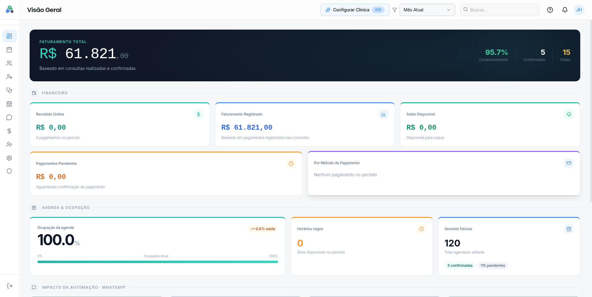
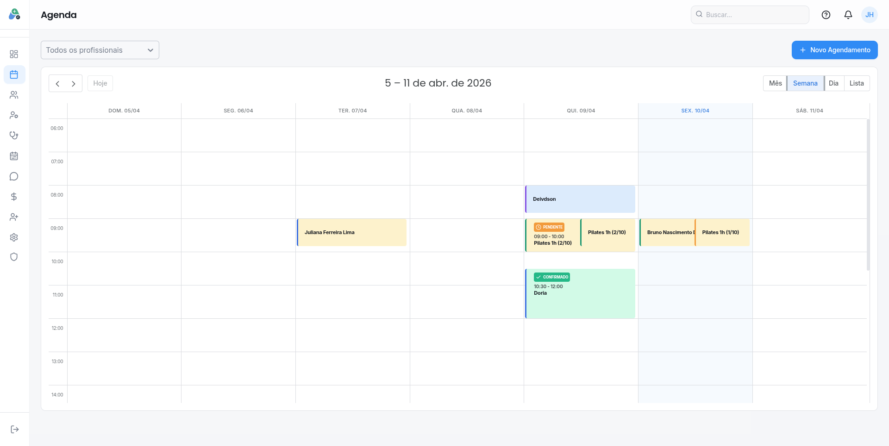
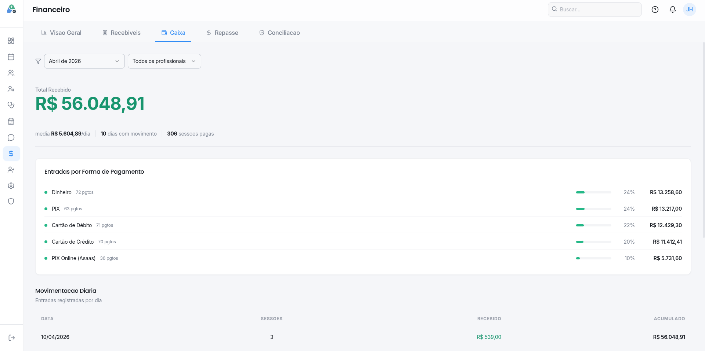
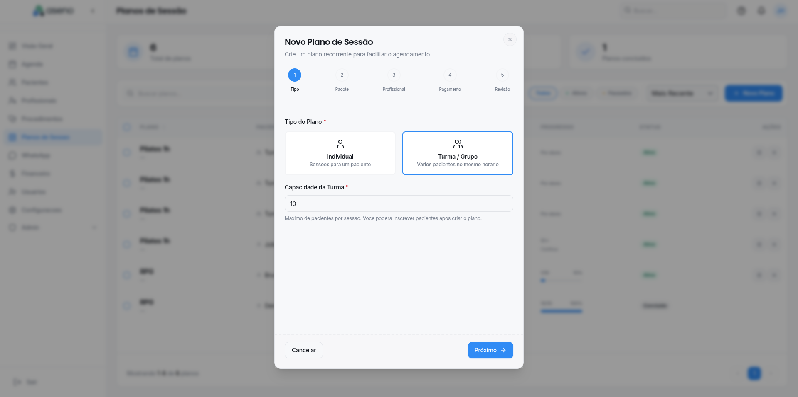
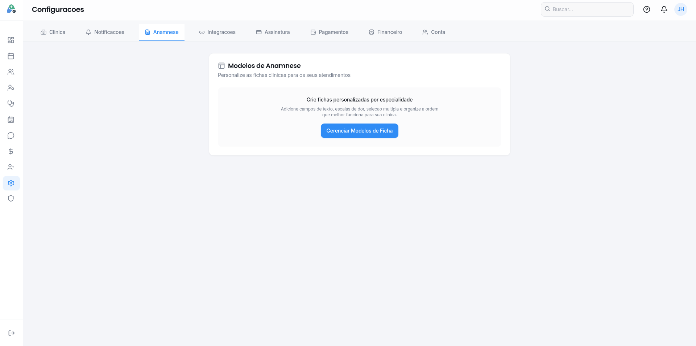
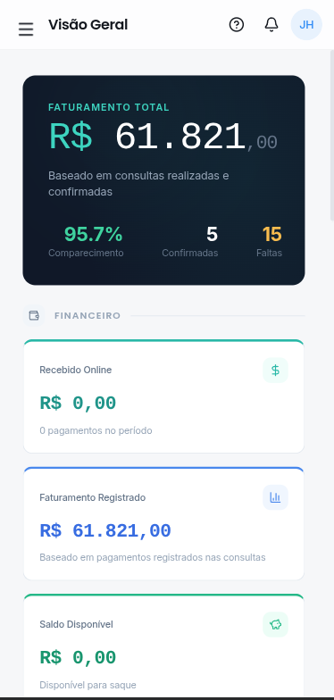

<div align="center">

# Aseno — Frontend

**The web app of Aseno, a SaaS that runs health and wellness clinics end to end.**

Schedule, patients, finances and WhatsApp in one place, plus the public pages where patients book and pay online.


<br/>



</div>

---

## Overview

Aseno is used by physiotherapy, aesthetics, psychology, pilates and other clinics to manage their
day to day. This repository holds everything the user sees: the clinic dashboard, the patient-facing
pages and the marketing site. It talks to the Go API in [backend](https://github.com/aseno-up/backend)
and is deployed on Kubernetes through [k8s](https://github.com/aseno-up/k8s).

## Screens

<table>
  <tr>
    <td width="50%"><br/><sub><b>Schedule</b> — weekly and monthly views, drag to reschedule</sub></td>
    <td width="50%"><br/><sub><b>Finance</b> — cash flow, commissions and lost revenue</sub></td>
  </tr>
  <tr>
    <td width="50%"><br/><sub><b>Session plans</b> — recurring treatments and group classes</sub></td>
    <td width="50%"><br/><sub><b>Intake forms</b> — each clinic builds its own anamnesis</sub></td>
  </tr>
</table>

## What is inside

**Clinic dashboard**
- Schedule with individual appointments, group classes and waitlist
- Patients, health records and customizable intake forms
- Finance: cash flow, sales and packages, commissions, reports
- WhatsApp inbox with the AI agent and human takeover
- Team, roles and permissions, procedures, insurance plans and clinic settings
- Guided onboarding and in-app tutorials

**Patient-facing pages**
- Public clinic page and online booking (`/clinica/[slug]`, `/agendar/[slug]`)
- Online payment and receipts (`/pagar/[token]`, `/recibo/[token]`)
- Patient portal to sign up, log in and manage appointments (`/portal`)

**Marketing site**
- Landing page and one page per specialty (physiotherapy, aesthetics, psychology, nutrition, pilates and more)
- SEO with sitemap, robots and per-page metadata
- Available in Portuguese and English

<div align="center">

<br/><sub>Fully responsive: clinics run their day from the phone.</sub>
</div>

## Tech stack

| | |
|---|---|
| Framework | Next.js 15 (App Router), React 18 |
| Language | TypeScript |
| UI | Tailwind CSS, shadcn/ui, Radix UI |
| Forms and validation | React Hook Form, Zod |
| State | Zustand |
| Calendar | FullCalendar |
| Internationalization | i18next (pt-BR, en) |
| HTTP | Axios |
| Delivery | Standalone Docker image on GHCR, deployed to Kubernetes on version tags |

## Project structure

```
src/
  app/
    [lng]/
      (auth)/          login, sign-up, onboarding
      (dashboard)/     the clinic app: agenda, pacientes, financeiro, whatsapp, ...
      (landing)/       marketing site and specialty pages
    agendar/  clinica/ public booking and clinic pages
    pagar/  recibo/    online payment and receipts
    portal/            patient portal
  components/          shared components and shadcn/ui primitives
  hooks/  stores/      permissions, onboarding, auth state
  lib/  types/         API client, helpers and shared types
public/locales/        translations
```

## Running locally

Requirements: Node.js 20+ and the [backend](https://github.com/aseno-up/backend) running.

```bash
npm install

# point the app to the API
echo "NEXT_PUBLIC_API_URL=http://localhost:4901/api/v1" > .env.local

npm run dev        # http://localhost:3001
```

Other commands:

```bash
npm run build      # production build
npm run lint       # lint
```

## Deployment

Pushing a tag like `v1.4.0` triggers GitHub Actions, which builds a standalone Docker image,
publishes it to GitHub Container Registry and rolls it out to the Kubernetes cluster.

---

<div align="center">
Built by <a href="https://github.com/jhamiltonjunior">Hamilton Santos</a>
</div>
